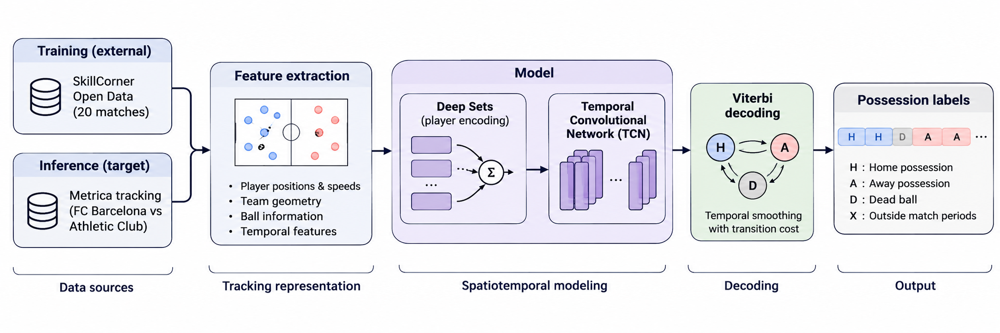

# Tracking-Only Football Possession Reconstruction (TITLE NEEDS TO BE CHANGED)

## 1. Introduction and Approach Overview

### 1.1 Task Definition

Phase 1 of the Metrica Sports *More Than a Hack 2027* challenge aims to reconstruct team possession in the FC Barcelona vs Athletic Club match using the provided data. The objective is to assign one of four labels to each of the 199,319 frames: Home possession (`H`), Away possession (`A`), Dead ball (`D`), or Outside the scored match periods (`X`).

Determining possession from tracking data is not as straightforward as identifying the player closest to the ball. During a match, the ball frequently travels between players, becomes temporarily uncontrolled after challenges or deflections, or disappears from the tracking feed. The model must therefore consider the surrounding play and distinguish temporary situations from actual changes in possession.

The challenge's primary evaluation metric is **possession-spell F1**, which measures how well complete Home and Away possession intervals are reconstructed.

### 1.2 Proposed Approach

We developed a tracking-only approach based on a **Deep Sets encoder combined with a noncausal Temporal Convolutional Network (TCN)**, followed by Viterbi decoding. The model is trained using external matches from SkillCorner Open Data and applied to the Metrica tracking data without training on the provided game's ground-truth labels.

The approach consists of four main components:

1. **Tracking preprocessing and feature extraction.** SkillCorner and Metrica tracking data are converted into a common representation containing player positions, speeds, team geometry, ball information, and observation-validity indicators.

2. **Deep Sets player encoding.** Players are represented as unordered sets rather than fixed identities. This is important because tracking slots are not necessarily consistent over time, and some players may be missing from individual frames. Deep Sets allows the model to learn team representations independently of player ordering.

3. **Temporal modeling with a TCN.** Possession is a continuous state that evolves over time, rather than an independent decision at every frame. The noncausal TCN uses observations before and after each frame to identify sustained control, turnovers, and stoppages. Using future context is appropriate because the challenge requires offline reconstruction of a completed match.

4. **Viterbi decoding.** Frame-level predictions can fluctuate during passes, challenges, or tracking errors. Viterbi decoding introduces a cost for switching between possession states, encouraging continuous possessions while allowing transitions when supported by the model's predictions.

We chose this architecture to combine information about individual players and team structure with temporal context. The final system uses only the provided tactical player and ball tracking data. Video, homographies, and automatic Smart Tags were considered during development but are not required for the final predictions.

The following sections describe the training data, feature representation, model implementation, experimental decisions, and limitations of the approach.

## 2. Data Sources and Label Generation

### 2.1 Data Sources and Assets

Our model is trained using **[SkillCorner Open Data](https://github.com/SkillCorner/opendata)**, an openly available football dataset released by SkillCorner in collaboration with PySport. We use 20 matches from the 2024/25 Australian A-League season, containing player and ball tracking data at 10 Hz, together with match metadata and tactical annotations generated by SkillCorner.

For each match, the dataset provides several files:

- **Match metadata (`_match.json`):** Information about the teams, players, pitch dimensions, and match periods.
- **Tracking data (`_tracking_extrapolated.jsonl`):** Frame-by-frame positions of players and the ball, including player identifiers, team information, and tracking availability.
- **Phases of Play (`_phases_of_play.csv`):** Intervals describing the tactical phase of both teams, including which team is considered to be in possession.
- **Dynamic Events (`_dynamic_events.csv`):** Information about individual player actions and possession-related events.

The tracking data is used to extract the spatial and temporal features required by our model, while Phases of Play provide the supervision used to generate Home, Away, and Dead-ball labels. Dynamic Events were explored during the development of an alternative, more conservative labeling strategy but are not used in the final label generation. All training labels are derived from SkillCorner's existing annotations rather than manually created for this project.

For inference, we use the **tactical tracking data provided by Metrica Sports** for the FC Barcelona vs Athletic Club match. This includes player and ball positions, player speeds, team information, and tracking-validity information at 25 Hz. These observations are converted into the same feature representation used for SkillCorner, allowing the trained model to be applied to the target match.

The provided broadcast videos were neither explored nor used. We also investigated the automatic **Smart Tags**, which describe tactical situations such as build-up, progression, and attacking transitions. We experimented with using these tags as additional evidence for possession prediction, but they were not included in the final approach.

### 2.2 Training Data and Label Construction

SkillCorner does not directly provide a complete frame-level classification into Home possession (`H`), Away possession (`A`), and Dead ball (`D`). We therefore construct these labels from the **Phases of Play** annotations.

According to SkillCorner's documentation, Phases of Play are defined when the ball is in play. Each phase provides a time interval and identifies the team in possession through `team_in_possession_id`. We use this information to assign the corresponding Home or Away label to every frame covered by a valid phase.

For frames within the official match periods (P1 and P2) that are not covered by a valid Phase of Play, we assign `D`. This follows the assumption that gaps between annotated phases correspond to situations when the ball is out of play, such as fouls, throw-ins, corners, or other stoppages.

The resulting labeling procedure is:

1. Identify the official first- and second-half intervals using match metadata.
2. Initially assign `D` to all frames within these periods.
3. Assign `H` or `A` to frames covered by valid Phases of Play, according to the team in possession.
4. Exclude frames outside the official match periods, including halftime, from training.

This produces a complete **H/A/D labeling scheme**, without an Unknown class within the official periods. The original frame indices and period boundaries are preserved, and phases are handled independently within each half.

The main advantage of this strategy is that it provides supervision for every in-period frame, including dead-ball situations. However, it assumes that SkillCorner's Phases of Play cover all live-play intervals. Although SkillCorner states that phases are defined only when the ball is in play, it does not explicitly guarantee complete coverage. Missing or incomplete phase annotations could therefore result in live-play frames being incorrectly labeled as dead ball.

These labels are consequently treated as **provider-derived weak supervision**, rather than independently verified possession ground truth. No labels from the provided Metrica match are used for training.

## 3. Methodology

### 3.1 Cross-Provider Feature Extraction

Since the model is trained on SkillCorner data and applied to Metrica tracking, both datasets must be converted into a consistent representation. We developed a common feature-extraction pipeline that uses player positions, speeds, team geometry, and ball information, while accounting for missing or incomplete observations.

Player and ball coordinates are converted into a canonical pitch-centered coordinate system, measured in metres, with the Home team always attacking towards the positive x-direction. This ensures that the model receives a consistent spatial representation regardless of the original tracking provider or match half.

The input features are divided into two groups:

- **Player-level features:** Each player is represented by five values: x and y coordinates, speed, position validity, and speed validity. Players are grouped by team, with up to 24 tracking slots per team to accommodate incomplete or duplicated observations.
- **Frame-level features:** A total of 51 engineered features describe team centroids, spatial dispersion, compactness, player counts, speed statistics, relative team positioning, ball movement, ball-to-player proximity, and temporal changes in team geometry.

Missing measurements are represented using neutral zero values together with explicit validity indicators. This allows the model to distinguish between a genuine observation and an unavailable measurement. Feature normalization is fitted exclusively on the SkillCorner training data and subsequently applied to Metrica.

SkillCorner tracking is provided at 10 Hz, whereas Metrica operates at 25 Hz. For inference, each official Metrica half is independently resampled to 10 Hz using the nearest timestamp, without interpolation. Predictions are later mapped back to the original 25 Hz timeline to generate the submission.

### 3.2 Deep Sets + TCN Architecture

Our model combines a Deep Sets encoder for spatial representation with a Temporal Convolutional Network (TCN) for temporal modeling.

**Deep Sets encoder.** At each frame, the same multilayer perceptron (MLP) is applied independently to every player, transforming the five player-level input features into a 64-dimensional embedding through layers of sizes `5 → 32 → 64`. The embeddings of players with valid positions are then aggregated using masked mean pooling, separately for Home and Away. This produces two team representations without relying on player ordering or persistent player identities.

The resulting Home and Away embeddings are concatenated with the 51 engineered frame-level features, combining individual player information with broader tactical and movement characteristics.

**Temporal Convolutional Network.** The combined representation is processed by a noncausal TCN consisting of five residual blocks with dilations `[1, 2, 4, 8, 16]` and kernel size 3. The network has a receptive field of 125 frames, corresponding to approximately 12.4 seconds of observations at 10 Hz, centered around the frame being classified.

This temporal context helps distinguish sustained possession from brief changes in player proximity, loose-ball situations, or tracking fluctuations. Unlike a causal model, the TCN can use both past and future observations, which is appropriate for an offline possession-reconstruction task.

The final classification layer produces three logits per frame, corresponding to Home possession (`H`), Away possession (`A`), and Dead ball (`D`). These are converted into class probabilities using softmax.

### 3.3 Training Strategy

The model is trained using the SkillCorner H/A/D labels described in Section 2. During development, we experimented with different labeling strategies and loss functions, ultimately selecting **possession-duration weighted cross-entropy**.

Standard cross-entropy assigns equal importance to every frame, meaning that longer possessions contribute more to the training loss simply because they contain more frames. However, the challenge's primary metric evaluates possession spells regardless of their duration. To better align training with this objective, we assign higher weights to frames belonging to shorter Home and Away possessions and lower weights to those belonging to longer possessions. Dead-ball frames retain a weight of 1, while H/A spells touching official period boundaries also receive a neutral weight because their complete duration may be unknown.

Training is performed on temporal sequences with additional context frames around each sequence. These frames provide the TCN with the necessary temporal information, while the loss is calculated only on the central frames to avoid artificial boundaries introduced by splitting the match into smaller sequences.

For model development, the 20 SkillCorner matches were divided into **16 training matches and 4 validation matches**, ensuring that no match appeared in both sets. Checkpoint selection was based on possession-spell F1 calculated after applying Viterbi decoding with a fixed transition penalty of `1.5`, selected in earlier experiments. This aligns checkpoint selection with the challenge's primary evaluation metric rather than relying only on frame-level accuracy.

After selecting the training configuration and number of epochs, the final model was retrained using **all 20 SkillCorner matches**, with the architecture, hyperparameters, and decoding configuration frozen. No labels from the provided Metrica match were used for training or model selection.

### 3.4 Temporal Decoding and Possession Rules

Although the TCN incorporates temporal information, its output consists of frame-level class probabilities. Directly selecting the most probable class at every frame can introduce short and unrealistic possession changes, particularly during passes, challenges, or tracking errors.

To reduce this fragmentation, we apply a **Viterbi decoder** over the three possession states (`H`, `A`, `D`). The decoder finds the sequence of states that best explains the predicted probabilities while penalizing changes between states. This encourages continuous possession intervals without preventing transitions when sufficient evidence supports them.

Our approach does not explicitly detect every football event or apply separate rules for tackles, passes, or fouls. Instead, the possession rules are represented through the learned model and temporal decoding. Similarly, dead-ball periods and restarts are inferred from tracking information rather than explicit event or referee-whistle detectors.

Each official match half is processed and decoded independently, preventing temporal context or possession spells from crossing halftime. Frames outside the scored periods are assigned `X` when generating the final 199,319-frame submission.

